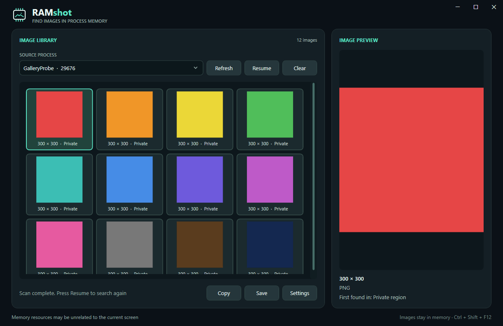

# RAMshot

A Windows application built with C# and WPF that searches for PNG, JPEG, GIF, BMP, and WebP images in the readable memory of the selected process. Found images appear in the gallery and stay in memory; the selected image can be copied to the clipboard or saved to disk in the same format, byte-for-byte. Animated GIF and WebP files play in the preview and are saved unchanged.



## Usage

1. Launch RAMshot. It tries to select the most recently active window and starts scanning immediately; verify the selected process and change it in the list if needed.
2. Click an image to preview it. **Copy** copies the current frame to the clipboard (the Windows clipboard does not carry animations); **Save** writes the original file bytes to disk in the same format (PNG, JPEG, GIF, BMP, or WebP) through the standard save dialog. The default file name is `<first 16 SHA-256 hex characters>.<extension>`; you can change it in the dialog. Nothing is re-encoded, so pixels, animation, palettes, and metadata are preserved. Hold **Ctrl** and click to select several images; with more than one selected, **Save** asks for a folder and writes every selected file there under its hash name, and **Ctrl+A** selects all images. The gallery keeps a 256 px thumbnail and the original file; the full-resolution image is decoded on demand for the preview, and gallery cards show the thumbnail. The preview supports wheel zoom, middle-button drag panning, right-button double-click reset, and a checkerboard background behind transparency. GIF and WebP animations honor individual frame delays; animations that exceed the preview limits fall back to the first frame.
3. Scanning stops when the current portion is filled or a pass over memory completes. **Resume** starts the next portion while keeping found images; after a completed pass it starts a new pass and adds only new images — already found ones are not duplicated (deduplicated by SHA-256). **Clear** empties the gallery and the hash history, so the same images may appear again. **Pause**, **Clear**, and **Refresh** control scanning and the gallery.
4. The **Settings** button opens scan and gallery limits. **Apply settings** saves changes without restarting the scan; new parameters apply from the next batch, and a new portion size applies from the next portion. Fields accept digits only. After a successful save the button shows **Applied** and returns to **Apply settings** when settings change, the panel is toggled, or an image is selected. The **Show tooltips** switch below the hotkey switch hides all hover hints; it is enabled by default and takes effect when settings are applied.

The window has no system title bar: minimize, maximize/restore, and close buttons are in the top-right corner. Closing the window minimizes it to the tray. To exit completely, use **Exit** in the tray icon menu. Launching the app again while it is already running shows a message; open the window from the tray or with **Ctrl + Shift + F12** (the hotkey can be disabled in Settings). F12 is reserved by Windows for debugging, so conflicts with other applications are possible.

The application runs as administrator: Windows shows a UAC prompt on every start. This is needed to read memory of processes with higher privileges; if elevation is declined, the application will not start.

Defaults: up to 512 MiB per batch, up to 16 MiB per encoded image, 2 seconds per batch, image dimensions from 128 to 4096 pixels, 80 new images per portion, up to 200 MiB in the gallery (thumbnails plus original files), and a 1 second pause between batches. `Mapped` and `Image module` regions are not scanned by default; they can be enabled in Settings. The memory limit applies regardless of the portion size. Settings are stored in `%LocalAppData%\RAMshot\settings.json`; if the file is corrupted or contains invalid values, the defaults are used.

## Limitations

RAMshot reads only the readable memory of the selected process. Results may be resources or stale images rather than what is on screen. Images in other processes' memory, on the GPU, in inaccessible memory, in unsupported formats, or split across regions may not be found. Windows may deny access; the application runs with administrator rights (see above) but does not inject into the target process or bypass process protection.

By default the application searches only private (`Private`) memory regions and skips file-mapped views (`Mapped`) and module images (`Image module`); these regions can be enabled in Settings. The `Private`, `Mapped`, or `Image module` label shows the region type where a particular copy of the image was first found. It does not establish the image's origin: the process may contain resources from loaded libraries, including system icons. Size filters and limits in Settings apply to all formats.

## Build

Requires 64-bit Windows 10/11 and the .NET 8 SDK with Windows Desktop Runtime; the application scans memory from a 64-bit process:

```powershell
dotnet build .\sources\RAMshot.csproj -c Release
dotnet run --project .\sources\RAMshot.csproj -c Release
```

To produce the release single-file executable:

```powershell
dotnet publish .\sources\RAMshot.csproj -c Release
```

The output is one file, `sources\bin\Release\net8.0-windows\win-x64\publish\RAMshot.exe` (about 12 MB). It is framework-dependent: the target machine needs the .NET 8 Desktop Runtime. For a self-contained build add `-p:SelfContained=true`. Debug symbols and unused runtime assets are excluded from the publish output.

The `RAMshot.slnx` solution file opens in Visual Studio 17.13+ and builds with .NET SDK 9.0.200+; the projects themselves (`sources`, `tests`) also build with the .NET 8 SDK.

Scanner regression tests over controlled memory contents (block boundaries, resumption across portions, original bytes for all formats, animated GIF and WebP decoding, and JPEG with large metadata):

```powershell
dotnet run --project .\tests\ScannerRegression\ScannerRegression.csproj -c Release
dotnet run --project .\tests\ScannerRegression\ScannerRegression.csproj -c Release -- 8
```

To check the gallery and preview manually, start `GalleryProbe` (it keeps twelve generated PNGs plus an animated GIF and an animated WebP in memory) and then launch RAMshot while the probe window is in the foreground:

```powershell
dotnet run --project .\tests\GalleryProbe\GalleryProbe.csproj -c Release
```

The application project and its sources are in `sources`; tests are in `tests/ScannerRegression`, and `tests/GalleryProbe` is a helper process that keeps twelve generated PNGs plus an animated GIF and WebP in memory so the gallery, animations, and save can be checked manually. The project is split into the WPF view, ViewModel, memory scanning service, and image saving. The application icon source is in `sources/Assets/RAMshot.svg`.

## License

MIT